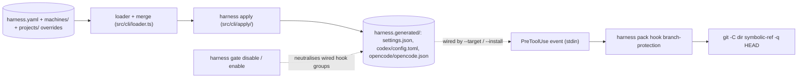

# Architecture

This document is the architecture reference for the shipped `harness` CLI 1.0.0: the manifest schema, the file layout, the CLI surface, the override rules and the one runtime gate. [`VISION.md`](VISION.md) established *why* a declarative control plane exists; this document describes *what* the tool is.

`harness` does two things. It composes one YAML manifest, plus its per-machine and per-project override layers, into runtime configuration for Claude Code, Codex and (minimally) opencode. And it ships one runtime gate, the branch-protection policy pack, which asks git for the branch of every directory a tool call writes into and refuses the call on a protected branch, on an unanswered query, or on an error.

## Architecture overview



On the authoring side, the load is: base manifest, then `machines/` override layers, then one `projects/<name>` layer; layers merge as raw YAML and the merged document is parsed strictly once. `harness apply` regenerates `harness.generated/` from the effective manifest (refusing to clobber hand-edits, section 7), expands `policy_packs[]` into hook entries, writes `harness.lock`, and prints restart hints when MCP servers, the memory router or hooks changed.

On the runtime side, hooks are shell commands the runtime invokes with an event JSON on stdin. The branch-protection blocker answers per its runtime contract (a JSON deny envelope for Claude Code, exit 2 with the reason on stderr for Codex via `--runtime codex`). A manifest that fails to load makes the gate refuse every call; `harness gate disable` / `enable` is the operator switch that takes the wired hook groups out and back.

---

## 1. Manifest: top-level shape

A harness configuration is a single YAML file, by default `~/.harness/harness.yaml` (`--config <path>` names another). The accepted top-level keys are defined in `src/schema/index.ts`:

```yaml
version: 1        # required; integer literal 1, nothing else parses
grounding: {}     # evidence wiring (section 2)
tools: {}         # mcp + cli + skills + builtin inventory (section 3)
memory: {}        # directories, router, retention (section 4)
hooks: []         # event-bound shell commands (section 5)
policy_packs: []  # builtin packs such as branch-protection (section 6)
```

Everything except `version` is optional and defaults to empty. The parse is strict: any other top-level key, and any typo inside a known section, fails it. The one exception is a pack's `config` block (section 6), which the load accepts as-is and `harness validate` checks against the pack's own schema. A manifest that fails to parse makes every verb that loads it fail (exit 66; `harness validate` reports it as error diagnostics).

Keys, hook fields and pack names that releases removed are the one exception to strictness: they load, warn once, and are stripped before the parse (`src/schema/removed-keys.ts`). The `policies:` list, `workflows:` and `review_templates:` are removed keys among them; the module header names the full table. An empty value of some removed keys (for example `policies: []`) is stripped silently, and `harness validate --strict` fails on the warnings. This posture is deliberate: every hook loads the manifest and the branch-protection gate refuses every call when a load fails, so a manifest carrying a key a newer release removed must warn, not lock the machine out. Hooks or pack configs that still *call* a removed harness command parse fine but produce warnings naming each site, because `harness apply` would re-render a command that no longer exists.

## 2. grounding: section

```yaml
version: 1
grounding:
  session:
    auto_start: true                     # reserved: nothing reads it
    id_format: "gs-{repo}-{rand:8}"      # reserved: nothing reads it
  evidence_ledger:
    path: ~/.evidence-ledger/ledger.db   # projected as EVIDENCE_LEDGER_DB
tools:
  mcp:
    - name: grounding-mcp
      command: [node, /opt/grounding-mcp/dist/server.js]
```

What is still read:

- **`grounding.evidence_ledger.path`** (default `~/.evidence-ledger/ledger.db`) is projected by `harness apply` as the `EVIDENCE_LEDGER_DB` env on the `tools.mcp[]` entry named `grounding-mcp`, the variable grounding-mcp's ledger-bridge reads (`src/cli/apply/generate-settings.ts`). The projected value is `~`-expanded to an absolute path. The projection fires only when such an entry exists, and an operator-declared non-empty `env.EVIDENCE_LEDGER_DB` on the entry wins; `harness doctor` checks the effective path is writable (or creatable) and flags a diverging override.
- **`grounding.session.auto_start`** (default `true`) and **`session.id_format`** (default `gs-{repo}-{rand:8}`) are RESERVED: validated and round-tripped, but nothing reads them (`src/schema/grounding.ts`). Do not wire them speculatively.

`grounding:` is the section that *configures* the `grounding-mcp` tool entry; it is not an enforcement switch. The removed subkeys `evidence_ledger.retention_days` and `policies_source` load with a warning and are stripped.

## 3. tools: section

Tool registrations, explicitly typed by sub-block (`mcp`, `cli`, `skills`, `builtin`); the four do not share a parent schema because their lifecycle and health semantics differ.

```yaml
version: 1
tools:
  mcp:
    - name: codebase-oracle
      command: [npx, tsx, ~/git/pandora/codebase-oracle/src/mcp-server.ts]
      health: {verb: oracle_list_repos, timeout_ms: 5000}
      enabled: true
    - name: agent-tasks
      command: [node, ~/git/pandora/agent-tasks/mcp-server/dist/server.js]
      enabled: false          # dropped from generated runtime config (opencode: disabled marker)
  cli:
    - name: git-batch
      binary: git-batch
      required: false
    - name: gh
      binary: gh
      required: true
      version_command: [gh, --version]
  skills:
    enabled: [simplify, review]
    source_dirs: [~/.claude/skills]
  builtin:
    known: [Read, Edit, Write, Bash, Agent, Skill, TaskCreate, Glob, Grep]
```

### `tools.mcp[]`

| Field | Type | Required | Notes |
|---|---|---|---|
| `name` | string | yes | unique within `tools.mcp` |
| `command` | `string` or `string[]` | yes | a string is split on whitespace; paths containing spaces must use the array form |
| `env` | `{string: string}` | no | a value starting with a literal `~/` warns: the child process treats it as cwd-relative |
| `health` | `{verb, timeout_ms?}` | no | MCP verb `harness doctor` invokes for liveness (default 5000 ms; `--shallow` skips probes) |
| `enabled` | boolean (default `true`) | no | `false` drops the entry from the generated runtime config (`src/cli/apply/generate-settings.ts`) and from `harness.lock` (`src/io/harness-lock.ts`) |
| `min_version` / `version_command` | string / `string[]` | no | semver floor; doctor probes `version_command` (default: first command token, `--version`) and warns when below |

`enabled: false` is the kill switch on every projection: the entry is absent from the Claude Code settings shape, from the Codex artifact and from the lock. The one exception is the opencode artifact, where it is emitted as a bare `{"enabled": false}` marker because opencode merges config sources and an omitted key would not override another source's declaration. User-scope MCP registration happens only through the `claude mcp` CLI during `harness init --interactive`; harness never writes an `mcpServers` block into settings.json, because Claude Code does not read one there.

### `tools.cli[]`

`name` and `binary` are required (`binary` resolved via `$PATH` unless absolute). `required: true` turns a missing binary into a `validate` error; non-required ones warn. `min_version` plus optional `version_command` (default `[binary, --version]`) is a doctor/validate floor.

### `tools.skills` and `tools.builtin`

`skills.enabled` lists skill names; `skills.required` must be a subset (schema-enforced) and `validate` fails when a required skill has no `SKILL.md` under any `source_dirs` entry. Skills are an inventory surface: they are validated and listed, not projected into settings. `builtin.known` is inventory only; `validate` warns one-sidedly when the runtime advertises a built-in the manifest does not list.

## 4. memory: section

Memory lives in markdown with frontmatter; harness generates only the index over it and never writes the memory files.

```yaml
version: 1
memory:
  directories:
    - path: ~/.harness/projects/{project}/memory
      scope: project
  router:
    command: [memory-router-user-prompt-submit]
    enabled: true
  retention:
    staleness_days: 180
  scopes:
    default: project
    allowed: [project, user]
```

- **`directories`** is a list of `{path, scope}` with scope `project` or `user`. The `{project}` placeholder expands to the `--project <name>` context; a templated directory without that context is skipped. `harness apply` regenerates `harness.generated/MEMORY.md` as an index over the markdown files found here.
- **`router`** wires the memory-router: an argv array plus `enabled`. When present and enabled it projects into a synthetic `memory:router` `UserPromptSubmit` hook (5 s budget) in the Claude Code and Codex artifacts, so per-prompt augmentation actually fires. The `memory:` hook-name prefix is reserved for that projection; a declared hook using it fails the parse. Optional `min_version` + `version_command` follow the doctor floor contract.
- **`retention.staleness_days`** (default 180) is what `harness doctor` uses to flag untouched memory files. `retention.broken_refs` is validated but INERT: no consumer reads it yet.
- **`scopes`** is validated (the default must appear in `allowed`) but likewise INERT; consumers use the per-directory `scope` field.

## 5. hooks: section

Each hook is a shell command bound to a runtime event, with an optional tool-name match, a blocking level and a timeout budget.

```yaml
version: 1
hooks:
  - name: secret-scan
    event: PreToolUse
    match: "Write|Edit"
    command: ./hooks/secret-scan.sh
    blocking: hard
    budget_ms: 2000
    description: "Refuse writes whose payload carries a credential pattern."
  - name: session-note
    event: SessionStart
    command: ./hooks/session-note.sh
    blocking: false
```

| Field | Type | Required | Notes |
|---|---|---|---|
| `name` | string | yes | unique within `hooks`; the `memory:` prefix is reserved for harness's synthetic projections |
| `event` | enum | yes | `SessionStart`, `UserPromptSubmit`, `PreToolUse`, `PostToolUse`, `Stop`, `SubagentStart`, `SubagentStop`, `PreCompact` |
| `command` | string | yes | shell command; `validate` checks existence and `+x` when the first token is an absolute or `~/` path |
| `match` | regex | no | tool-name filter for the tool events (e.g. `"Write\|Edit"`) |
| `blocking` | `false` / `soft` / `hard` | yes | declared intent, recorded and shown; see below |
| `budget_ms` | integer (default 30000) | no | timeout budget; projected in seconds |
| `description` | string | no | surfaced by `harness describe` |
| `min_version` + `version_command` | string + `string[]` | no | both or neither; doctor probes the floor. Hook commands are arbitrary shell, so there is no sensible default probe |

`path_match` and `bash_match` were removed: a hook declaring one loads with a warning, the field is stripped and the hook stays.

Blocking semantics: `blocking` is the declared intent of a hook (`false`: informs only; `soft`: advisory warning; `hard`: a refusal aborts the tool call). harness records it and shows it in `harness doctor`, `harness list` and `harness describe`; it does not enforce it. Whether a hook actually blocks is decided by what the script returns under the runtime's hook contract, so a `blocking: false` hook that returns a deny still blocks. Declare the softest level that matches what the script does.

Projection (`src/cli/apply/generate-settings.ts`, `src/cli/apply/generate-codex-config.ts`): for Claude Code, hooks become the settings.json `hooks` section, `{event: [{matcher?, hooks: [{type: "command", command, timeout}]}]}`, grouped by event and matcher in stable order, deduped by (command, timeout). `matcher` is omitted when the manifest hook has no `match`. `timeout` is always emitted, in seconds: `budget_ms / 1000` rounded up with a 1 s floor. `blocking` does not survive the projection (it is display metadata, not runtime behaviour). For Codex, each hook becomes a `[[hooks.<Event>]]` stanza with a `matcher` (tool-name aliases expanded) and an inline `{ type = "command", command = ..., timeout = ... }` entry; `harness apply --runtime codex --install` merges them into `~/.codex/config.toml` inside a marked harness-managed block that replaces only its own fences.

### Hook content is shell, by design

Hooks are referenced by `command:` and execute as opaque shell. `validate` and `doctor` can confirm the file exists, is executable, and is present in the live runtime config; they cannot reason about the script's behaviour. Harness owns the wiring (which hook fires on which event with which budget), not the content; hook content is reviewed in source control like any other script. A hook script should stay thin: substantial logic belongs in a named tool with its own tests, not in a hook file.

## 6. Policy packs

`policy_packs[]` declares builtin packs that `harness apply` expands into hooks. A `policies:` list is a removed key (section 1).

```yaml
version: 1
policy_packs:
  - name: branch-protection
    source: builtin
    enabled: true
    config:
      protected_branches: [main, master, develop, release]
```

Entry fields (`src/schema/policy-packs.ts`): `name` (path-safe, unique), `source` (only `builtin` resolves in v1), `enabled` (default `true`), `description`, `config` (per-pack schema, checked by `harness validate`), and `min_version` (builtin packs ship inside harness, so a declared floor is reported as a warning, never enforced). Unknown sources and unknown builtin names are errors at validate and apply time; a pack name a release removed is stripped with a warning. `enabled: false` skips the pack at apply time entirely.

One builtin ships: **`branch-protection`** (`src/policy-packs/builtin/branch-protection.ts`; full behaviour in [`policy-packs/branch-protection.md`](policy-packs/branch-protection.md)). At apply time an enabled entry expands into:

- one PreToolUse hook, `policy-pack:branch-protection:pre-tool-use`, `blocking: hard`, 5000 ms budget, matching `Write|Edit` (Claude Code) or `apply_patch` (Codex), running `harness pack hook branch-protection` (with `--runtime codex` on Codex);
- `harness.generated/policy-packs/branch-protection/instructions.md`, the operator reference copy of what the pack does.

The hook (`src/cli/pack/hook-branch-protection.ts`, `src/runtime/git-branch.ts`) judges each event twice, as-written and physically-resolved paths, and refuses unless both allow. For each directory the call writes into it does a presence walk for a `.git` entry and, when one exists above the directory, asks git `git -C <dir> symbolic-ref -q HEAD` with every `GIT_*` variable removed from the environment, bounded at 2000 ms per call and 3000 ms per event. Outcomes: git names a protected branch, refuse and tell the agent to branch off; git cannot answer (error, timeout, missing git, unexpected output), refuse naming git's first stderr line; no `.git` above the directory (outside every repository) or a detached HEAD, allow. A manifest that does not load refuses every call. Branch names compare case-insensitively against `config.protected_branches`, default `master`, `main`, `develop`. Entries are exact branch names: there is no glob or prefix matching, so `release` protects only a branch named `release`.

Manage entries with `harness pack add|remove|list|reseed`; toggle them with `enabled: false` plus a re-apply, or neutralise the wired hook groups at runtime with `harness gate disable` / `enable` (section 9).

## 7. File layout

```
~/.harness/                                  state root (legacy: ~/.claude/)
├── harness.yaml                             user manifest; hand-edited
├── harness.lock                             apply-written asset lock (NDJSON)
├── harness.generated/                       apply outputs; gitignored
│   ├── settings.json                        Claude Code hooks section
│   ├── MEMORY.md                            index over memory.directories
│   ├── .last-apply                          last written files + manifest snapshot
│   ├── codex/config.toml                    --runtime codex artifact
│   ├── opencode/opencode.json               --runtime opencode artifact
│   └── policy-packs/<pack>/instructions.md  pack reference copy
├── machines/
│   └── <discriminator>.harness.overrides.yaml
└── projects/<project>/harness.overrides.yaml
```

- **State root.** Resolution order: injected root, then `$HARNESS_HOME`, then `~/.harness/` if present, then the legacy `~/.claude/` root if it still holds a `harness.yaml` or `harness.generated/` (with a one-shot deprecation warning), else `~/.harness/` created on first use. `harness migrate-home` `mv`s the manifest, the lock, the generated tree and the leftover `.understanding-gate/` directory of the removed gate from the legacy root to `~/.harness/`, plus the override layers (`machines/*.harness.overrides.yaml`, `projects/<name>/harness.overrides.yaml`) file by file, so other content in those directories (Claude Code's session transcripts under `projects/`) stays. Symlinked override layers are never moved: a layer file that is a link, and `machines/`, `projects/` or `projects/<name>` being a link, get a `move by hand` line and `--apply` exits non-zero until the layer under `~/.harness/` resolves, following links, to a regular file, the only kind of layer the loader reads. A top-level item that is itself a link is moved as a link, so a relative link target may then no longer resolve. Layers move before `harness.yaml`; a failure before `harness.yaml` moves is rolled back (moves undone, directories this run created removed), a failure after it leaves a partial state, and both exit non-zero. It never touches `settings.json`.
- **`harness.yaml` is the source of truth**; generated files are build artifacts and are regenerated by `apply`.
- **`harness.lock`** sits next to the manifest. NDJSON, one entry per line: `asset` (sha256 of each referenced hook script, MCP entrypoint, router binary), `memory-dir` (a Merkle hash per memory directory) and `target` (files written via `apply --target`). `harness apply` reports asset drift as warnings on every run; `validate --check-lock` surfaces it as warnings, and `apply --strict-lock` refuses with exit 1 instead of writing. Entries for `enabled: false` MCP servers and router are not locked (section 3).
- **`harness.generated/`** is gitignored; hand-edits there hit the drift rules below.
- **Live runtime files stay operator-owned**: Claude Code's `settings.json` (or `$CLAUDE_CONFIG_DIR`'s) is wired from the generated artifact via `apply --target <path> [--merge]`; Codex's `~/.codex/config.toml` only via the managed block from `--install`. Memory markdown and hook scripts are never written by harness.
- Nothing reads a `harness.d/` directory; fragment imports never shipped.

### Drift handling on apply

Generated files are owned by harness once you let it write them, but they predate harness and are edited by hand. Silently regenerating them is the failure mode harness avoids, so `apply` runs a three-state comparison per generated file (`src/io/three-state.ts`): manifest-expected, last-applied (from `harness.generated/.last-apply`), and on-disk-current. The four cells of the decision table:

| last-applied exists? | on-disk matches last-applied? | Verdict | Action |
|---|---|---|---|
| no | no on-disk file | `safe-overwrite` | write manifest-expected |
| no | on-disk file present | `drift-refuse` | refuse; hint `harness adopt <file>` |
| yes | yes | `no-drift` | write manifest-expected (safe) |
| yes | no (differs, or file gone) | `drift-refuse` | refuse with the diff; `adopt` it or `--overwrite-drift` |

A refusal exits 1. `harness adopt <file>` reads the hand-edited file, diffs it against manifest-expected and proposes the manifest patch that captures the difference (hooks from the file; MCP servers against the Claude Code registry). `--overwrite-drift` discards the on-disk state after an explicit confirmation (`--yes` for non-interactive use). Files harness does not generate stay user-owned: harness reads, validates and warns about them, never writes.

## 8. Override precedence

Per-machine and per-project deviation lives in override layers, merged into the base manifest in load order: base, then `machines/<discriminator>.harness.overrides.yaml` (in order `default`, the OS label, the hostname, most specific last), then `projects/<project>/harness.overrides.yaml` when `--project <name>` is given. The discriminator is `os.hostname()` (lower-cased), the OS label (`linux`, `darwin`, `wsl2` when `/proc/version` names microsoft, `win32`), or the literal `default`. All layers live under the state root, e.g. `~/.harness/machines/<discriminator>.harness.overrides.yaml`; per-host absolute paths belong there (`src/cli/init/templates.ts`, `src/cli/init/profiles.ts`).

Merge rules by value shape:

| Shape | Rule |
|---|---|
| Scalar | the layer value replaces the base value |
| Map | merged per key; layer keys win, base keys survive |
| List of entries with `name` | merged by `name`; a matching layer entry patches the base entry key by key, a non-matching one is appended in layer order |
| List without `name` | replaced wholesale |

```yaml
# ~/.harness/projects/acme/harness.overrides.yaml: disable one MCP server
version: 1
tools:
  mcp:
    - name: codebase-oracle
      command: [npx, tsx, ~/git/pandora/codebase-oracle/src/mcp-server.ts]
      enabled: false
```

Edge cases:

| Case | Behaviour |
|---|---|
| `null` value in a layer | removes the key from the effective manifest (tombstone) |
| `_delete: true` on a name-keyed entry | drops that entry from the effective manifest; omitting an entry never removes it |
| Empty, comment-only or `null` layer file | skipped with a warning; the manifest loads as if absent |
| Layer root is a scalar or list | the load fails naming the file (exit 66); a layer must be a mapping |
| `[]` in a layer | clears the list, name-keyed lists included (`tools.mcp: []` drops every MCP server) |
| List mixing entries with and without `name` | the load fails with a merge error naming the path (exit 70) |
| Layer adds a name the base lacks | appended after the base entries |
| Layer sets a key the base omitted | added |

Layers merge as raw YAML and the merged document is parsed once, so every layer must keep the document parseable: `version` merges like any scalar, and the merged manifest must still say `version: 1` (section 11). Removed keys are stripped from every layer before the merge, so a stale key can never fail a merge.

## 9. CLI surface

Single binary, `harness`. The manifest verbs take `--config <path>`, and the inspect verbs also take `--project <name>` and `--json`; `gate`, `uninstall` and `migrate-home` act on runtime files and the state root (`--settings`, a `--config` naming `config.toml` on the Codex runtime) rather than on the manifest.

```
harness describe [--pillar grounding|tools|memory|hooks]   effective merged manifest
harness validate [--strict] [--check-lock]                 lint manifest + referenced assets
harness doctor [--shallow] [--target <runtime>]            health summary; exit 1 on errors
harness list <mcp|cli|skills|memories|hooks> [--filter s]  flat listing per category
harness diff [--since <ref>] [--since-apply] [--memory-detail]
harness init [--template minimal|solo|team|full] [--force] [--probe] [--interactive]
harness add mcp|cli|skill|hook <name> [options]            managed manifest edits
harness remove <mcp|cli|skill|hook> <name>                 managed manifest edits
harness adopt <file> [--yes]                               capture hand-edits into the manifest
harness apply [options]                                    regenerate harness.generated/
harness export [--sanitize] [-o <file>]                    effective manifest as one file
harness pack add|remove|reseed <name> / pack list          manage policy_packs[] entries
harness pack hook branch-protection [--runtime codex]      the gate itself (runtime-invoked)
harness gate disable [--matcher <pat>] [--runtime codex]   operator off switch
harness gate enable [--runtime codex]                      restore from the snapshot
harness uninstall [--apply] [--restore-from <path>]        reversible teardown
harness migrate-home [--apply]                             ~/.claude -> ~/.harness
```

`apply` selects the adapter with `--runtime claude-code|codex|opencode` (default: the runtime stored by the previous apply, else claude-code): settings.json plus `--target` wiring for Claude Code, `harness.generated/codex/config.toml` plus a managed block in `~/.codex/config.toml` for `--install`, MCP-servers-only `opencode/opencode.json` for opencode (never auto-installed). `gate disable` removes hook groups whose matcher substring-matches `--matcher` from the live settings.json (or neutralises the managed Codex hook units in place), snapshots them, and prints the candidates when no matcher is given; `gate enable` restores from the live snapshot.

### Exit codes

BSD `sysexits.h` where applicable, extended with `1` where a linter-style failure is clearer than a BSD code:

| Code | Symbol | Meaning |
|---|---|---|
| 0 | - | success |
| 1 | - | a user-facing check failed: validate errors, doctor errors, apply drift refusal, gate refusals |
| 64 | `EX_USAGE` | bad CLI arguments (unknown command or option, missing argument, impossible flag combination) |
| 66 | `EX_NOINPUT` | the manifest or an override layer is missing, unreadable, not valid YAML, or fails the schema parse (`validate` reports parse failures as error diagnostics with exit 1 instead) |
| 69 | `EX_UNAVAILABLE` | an external process harness spawned failed (e.g. `diff --since` git calls) |
| 70 | `EX_SOFTWARE` | unexpected internal failure; an override layer whose list shape conflicts with the base (section 8) currently exits 70 too |

`harness pack hook branch-protection` follows its runtime contracts instead of sysexits: exit 0 with a JSON deny envelope blocks in Claude Code, exit 2 with the reason on stderr blocks in Codex.

## 10. Implementation stack

Node 20+ (`engines.node: ">=20"`), TypeScript, ESM. `tsc` builds `dist/`; the `harness` bin is `dist/cli/main.js`.

| Dependency | Purpose |
|---|---|
| `zod` | manifest schema validation and types |
| `yaml` | YAML parse/serialize (manifests, export) |
| `commander` | CLI parsing |
| `@inquirer/prompts` | the `init --interactive` wizard |
| `diff` | unified diffs (adopt, diff, apply) |
| `proper-lockfile` | file locking around managed manifest edits |
| `smol-toml` | the Codex config.toml artifact and managed block |

Dev tooling: `typescript`, `tsx`, `vitest`, `dependency-cruiser` (boundaries), `jscpd` (duplication). Tests run against source with vitest; the built `dist/` is what ships.

## 11. Versioning and backwards compatibility

The manifest version is an integer in the top-level `version:` key, currently `1` (`SUPPORTED_MANIFEST_VERSION`). It is not semver: the manifest has one consumer, the harness CLI, and breaking changes are migrations, not interface shifts.

The CLI's version errors carry actionable text instead of a bare literal mismatch (`src/schema/index.ts`): a missing key gets "add `version: 1`"; a higher numeric version gets "this CLI supports manifest version 1 ... re-run `npm i -g @lannguyensi/harness`", because a newer manifest means a newer CLI; anything else (lower number, quoted string, wrong type) gets a neutral unsupported-version message. These parse failures surface as exit 66 (or validate diagnostics).

Rules:

- Adding optional fields, new sub-blocks under an existing section, or new enum values is backwards compatible and does not bump `version`.
- Removing a field, removing an enum value, changing a default semantically, or changing merge rules bumps `version` to `2`. Today's removal mechanism is the warn-and-ignore posture of section 1: a removed key warns and is ignored rather than failing loads, so old manifests keep working without editing. That posture is one-way: warnings for keys that existed, strict failure for keys that never did.
- The CLI's own version (`harness --version`) follows normal semver, independent of the manifest version.

## 12. Out of scope

- Hook content. Hooks are shell; harness wires them and checks they are present, never interprets them.
- Owning operator config wholesale. Outside the Codex managed block and explicit `--target` writes, harness does not touch `settings.json` or `config.toml` keys it does not own.
- opencode hook projection. opencode has no declarative hook field, so `--runtime opencode` projects MCP servers only.
- Team and public memory scopes; `memory.scopes` is inert scaffolding.
- Any GUI or web surface. The CLI is the whole interface.

## Appendix: full override example

A per-project layer exercising each merge shape (as `~/.harness/projects/<project>/harness.overrides.yaml`):

```yaml
version: 1

memory:
  retention:
    staleness_days: 30            # scalar: replaces the base value

tools:
  cli:
    - name: git-batch
      binary: git-batch
      required: false             # merged by name into the base cli list

policy_packs:
  - name: branch-protection       # merged by name; branch set replaced
    config:
      protected_branches: [main, release]
```

A fuller reference manifest lives in [`examples/full-manifest.yaml`](examples/full-manifest.yaml).
