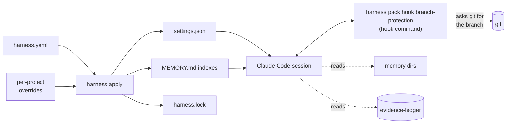
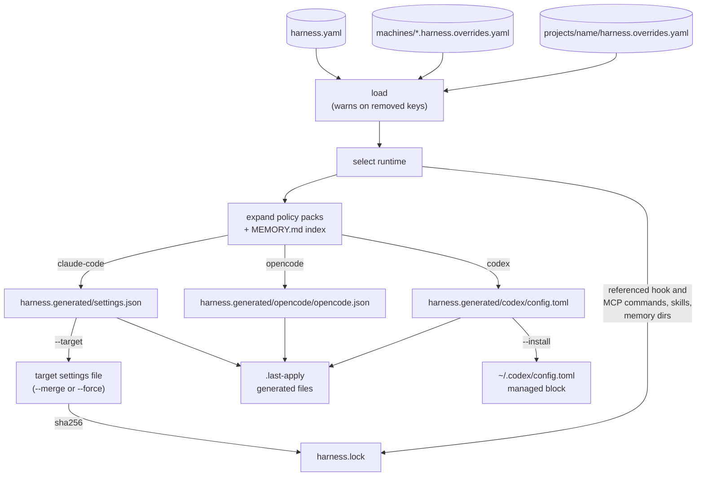

# harness, for humans

You are an operator: someone who installs harness, writes the YAML
manifest, runs `apply`, and watches the agent it configures behave the
way you said it should. This doc is the path from "fresh checkout" to
"my Claude Code session is gated by the rules I declared".

For the agent's view of the same system (which CLI verbs are safe to
call, how the gate messages read, how to read the ledger back), jump
to [`for-agents.md`](for-agents.md).

## 30-second pitch

`harness` is the declarative control plane for an agent harness. One
zod-validated `harness.yaml` describes grounding, tools, memory, hooks,
and policy packs. `harness apply` materialises that manifest
into the files Claude Code actually reads (`settings.json`, memory
indexes, sibling assets) and records a sha256 of every output in
`harness.lock`. You diff the manifest, not seven hand-edited files.

## Mental model



The manifest is the source of truth. Everything else is rendered. The
diagnostics (`validate`, `doctor`, `diff --since-apply`) tell you when
the rendered files have drifted from what the manifest currently says.

## Install

```bash
npm i -g @lannguyensi/harness
```

The CLI binary is `harness`. Node 20 or newer required.

## First-time setup (recommended)

If this is your first install on this machine, run the guided wizard:

```bash
harness init --interactive
```

It probes your environment (existing `~/.claude/` and `~/.codex/`, MCP
servers registered in Claude Code's user-scope registry `~/.claude.json`,
harness binary version), asks you to
pick a profile (`solo` / `team` / `full` / `custom`; `team` and `full` assume an agent-tasks account, `solo` is standalone), and writes a
validate-clean starting `harness.yaml` to `~/.harness/harness.yaml`
(legacy `~/.claude/harness.yaml` only when a pre-`v0.24.0` install is
already there).
Ctrl-C at any prompt aborts with no partial write. At the end it
offers to wire the manifest now: a checkbox per runtime, with the
runtimes it detected pre-checked, and for each one you tick it runs the
matching `harness apply`. Untick everything to review the manifest
first; the wizard then prints the commands to wire it by hand. Full walkthrough and
limitations in [`init-interactive.md`](init-interactive.md).

If you prefer a non-interactive bootstrap (CI, fresh-VM provisioning),
the next section walks the manual template path.

## First five minutes (manual template path)

1. Bootstrap a starter manifest into `/tmp/harness-demo/`:

   ```bash
   harness init --template solo --config /tmp/harness-demo/harness.yaml
   ```

   Valid templates: `minimal` (header only), `solo` (memory-router +
   branch-protection pack), `team` (solo + agent-tasks +
   grounding-mcp), `full` (the reference manifest: grounding, the tool
   inventory, memory and the branch-protection pack).

2. See what is in it:

   ```bash
   harness describe --config /tmp/harness-demo/harness.yaml --pillar tools
   harness list mcp --config /tmp/harness-demo/harness.yaml
   ```

3. Lint it:

   ```bash
   harness validate --config /tmp/harness-demo/harness.yaml
   harness doctor   --config /tmp/harness-demo/harness.yaml --shallow
   ```

4. Render the configured surfaces:

   ```bash
   harness apply --config /tmp/harness-demo/harness.yaml
   ```

   Output lands in `/tmp/harness-demo/harness.generated/`. By default
   nothing escapes that directory.

## Wire into Claude Code

To make Claude Code actually use the rendered settings, point `apply`
at a real settings discovery path with `--target`:

```bash
# Project scope: write straight to .claude/settings.local.json (created if missing).
harness apply --target .claude/settings.local.json

# User scope: merge harness-owned keys into your existing ~/.claude/settings.json,
# preserving env, permissions, enabledPlugins, and any other top-level keys.
harness apply --target ~/.claude/settings.json --merge
```

`--merge` replaces the target's `hooks` key wholesale with the
generated hooks and preserves every other top-level key verbatim.
`hooks` has no stable per-entry identity in the settings shape, so
hand-added hooks belong in the manifest (`harness adopt` pulls them
in). Re-applying is idempotent: running twice produces the same
target, and the second run reports `no changes`.

`harness apply` does not write MCP servers into `settings.json`,
because Claude Code does not read that block. Under `--merge`,
`mcpServers` entries that an earlier release wrote into the target, as
recorded in `.last-apply`, are dropped, and entries you added by hand
stay. Claude Code MCP servers are registered with
`claude mcp add-json --scope user <name> '<json>'`: `harness init
--interactive` does this for every enabled `tools.mcp[]` entry when
you tick claude-code in its wire-now step, and
after `harness add mcp` you run the command that `harness doctor`
prints under "Claude Code MCP Registration".

If the target exists and you pass neither `--merge` nor `--force`,
`apply` refuses with a clear hint instead of clobbering. `--force`
overwrites with the generated content as-is (no merge).

`harness.lock` records the target path plus a sha256 of the merged
output, so `harness validate --check-lock` flags out-of-band edits.

The diagram shows what one `harness apply` reads and writes for each
runtime, and where `--target` and `--install` fit. `.last-apply` keeps
the generated files; `harness.lock` hashes the hook and MCP commands,
skills and memory directories the manifest references, plus the
`--target` file.



## First hour: a real gate

The shipped gate is `branch-protection`: a `PreToolUse` hook that asks
git for the branch of the directory each `Write` / `Edit` (or
`apply_patch` on Codex) call writes into, and refuses when git names a
protected branch (default: `master`, `main`, `develop`). The `solo`,
`team` and `full` templates of `harness init` already enable it; on a
`minimal` or hand-written manifest add it with
`harness pack add branch-protection`. Then render the config:

```bash
harness validate
harness apply --target ~/.claude/settings.json --merge   # Claude Code; then restart it
```

See the gate decide without starting an agent: from inside a
repository on a protected branch, pipe a sample `Write` event into the
hook.

```bash
echo '{"session_id":"demo","tool_name":"Write","tool_input":{"file_path":"README.md"}}' \
  | harness pack hook branch-protection
```

On a protected branch it emits Claude Code's deny shape on stdout,
carrying both the legacy `decision: "block"` field and the Claude Code
2.1+ `hookSpecificOutput` envelope; on a feature branch it allows the
edit and says why on stderr. (`--runtime codex` blocks with exit 2 and
the reason on stderr instead.)

### Splitting the agent surface from the operator surface (`ux:`)

The pack's `config.ux:` block replaces the agent-facing
`permissionDecisionReason` with a plain-language three-section message
(`cannot` / `required` / `run`, `${BRANCH}` substituted). The
engine-vocabulary diagnostic (the directory git was asked about, the
protected list) stays on stderr for the operator. Every built-in
template (`solo` / `team` / `full`) ships the `ux:` defaults on the
branch-protection pack. The agent-facing reference is
[`for-agents.md`](for-agents.md#agent-facing-block-messages-ux-block).
Full pack reference:
[`docs/policy-packs/branch-protection.md`](policy-packs/branch-protection.md).

## What you should NOT do

- Do not hand-edit anything under `harness.generated/`. The next
  `apply` refuses until the edit is captured with `harness adopt` or
  discarded with `--overwrite-drift`. Edit the manifest instead.
- Do not bypass `harness.lock` drift warnings. They are the only
  signal that something other than `apply` touched a managed file.
- Do not mix `apply --target ...` with manual `cp harness.generated/
  ~/.claude/settings.json`. Pick one path.
- Do not skip `validate` before committing. The schema catches
  misnamed hooks and bad duration strings before they ship. A
  manifest that does not load fails the branch-protection hook closed:
  it refuses every edit until the manifest loads again.

## Switching a gate off (recovery / debug / incident-mode only)

Three situations need a way to take one hard-blocking hook out of the
live runtime config without `npm uninstall -g` and without
hand-editing `settings.json` or `~/.codex/config.toml`: lockout
recovery (a misconfigured gate is rejecting your shell), an A/B test
of "is this harness or my code?", and an incident hotfix (for example
a deliberate edit on a protected branch, which the branch-protection
gate refuses).

The verbs:

```bash
harness gate disable                          # list hook groups, write nothing
harness gate disable --matcher 'Write|Edit'   # remove matching groups (Claude Code)
harness gate enable                           # restore the live snapshot
harness gate disable --runtime codex --matcher apply_patch  # Codex hook units
harness gate enable  --runtime codex
```

On Claude Code the verb removes the matching hook groups from
`~/.claude/settings.json`, keeping a backup and a reversible snapshot;
`harness gate enable` puts the groups back. With `--runtime codex` it
neutralises the matching hook unit of the harness-managed block of
`~/.codex/config.toml` in place (`hooks = []`), so every other hook
keeps its position and Codex keeps its trust; a later
`harness apply --runtime codex --install` re-renders the block and
retires a snapshot taken before it. Each config keeps one live
snapshot: a second `gate disable` merges into it, and `gate enable`
restores it and retires it. If you edited the file in between, enable
refuses and names the way out (`--force` restores what is still off
and keeps your edits). A hook
whose manifest entry declares no `match` (the documented
runtime-reality hook entry, for example) has no matcher to target;
switch it off with its own switch (`RUNTIME_REALITY_DISABLE=1` for
runtime-reality) or give the entry a `match` and re-apply.
Branch-protection keeps refusing edits until you switch it off for real: to
land an edit on a protected branch on purpose (a hotfix on `master`,
for example), use the recipe above or
[Disable the gate](policy-packs/branch-protection.md#disable-the-gate-operator-only)
(Claude Code and Codex differ), and switch it back on afterwards.

The verbs are operator-only by intent and documentation, not by an
enforced check: there is no agent-session env-var or TTY refusal in
the CLI, so nothing in harness stops an agent with a Bash tool from
running them. The reversible snapshot and the `.bak.<timestamp>` file
next to the edited config are the recovery record either way. The
trust model, the exact flags and the recovery recipes are documented
in [`docs/okf/gate-kill-switch.md`](okf/gate-kill-switch.md).

**The gate kill switch is not for routine bypass.** To turn a shipped
gate off for good, set `policy_packs[].enabled: false` on the pack
(branch-protection) or remove the hook entry from the manifest, then
re-apply. Persistent, diff-able, source-controlled.

`harness pause` and `harness resume` were removed in 1.0.0 (task
973163a4): both verbs are unknown now, and `harness gate disable` /
`harness gate enable` are the operator off switch they used to
complement.

## Diagnostics cheat-sheet

| You want to know | Run |
|------|------|
| Effective merged manifest, with overrides applied | `harness describe` |
| One pillar only (grounding, tools, memory, hooks) | `harness describe --pillar <name>` |
| Flat row-per-entry view of one category | `harness list <category>` |
| Schema + asset issues (warnings + errors) | `harness validate` |
| Schema issues, plus drift since last `apply` | `harness validate --check-lock` |
| Health summary across all pillars (MCP probes, hook executability, memory dir state) | `harness doctor` |
| What changed since I last ran `apply` | `harness diff --since-apply` |
| Replay the historical policy decision rows (written pre-1.0.0) | `harness audit --since 24h` |
| Full chronological session export (transcript + ledger, redacted) | `harness session-export <sessionId>` |
| Take one hook group out of the live config (recovery / debug / incident), Claude Code | `harness gate disable --matcher <substring>` then `harness gate enable` |
| Take one hook unit out of the live config (recovery / debug / incident), Codex | `harness gate disable --runtime codex --matcher <substring>` then `harness gate enable --runtime codex` |
| Edit a protected branch on purpose (branch-protection off, from an operator shell) | see [Disable the gate](policy-packs/branch-protection.md#disable-the-gate-operator-only) |

## Where to read next

- [`docs/for-agents.md`](for-agents.md): how agents interact with the
  same harness instance, the gate messages, reading the ledger back.
- [`docs/ARCHITECTURE.md`](ARCHITECTURE.md): the original design
  (historical); [`docs/CLI.md`](CLI.md) is the current command
  reference, including the manifest's top-level keys.
- [`docs/ROADMAP.md`](ROADMAP.md): phases 1 through 7 with acceptance
  criteria.
- [`docs/VISION.md`](VISION.md): long-form positioning.
- [`docs/examples/full-manifest.yaml`](examples/full-manifest.yaml): a
  manifest that exercises every field.
- [`CHANGELOG.md`](../CHANGELOG.md): what shipped when.
