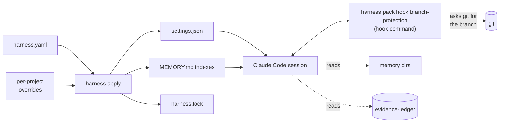
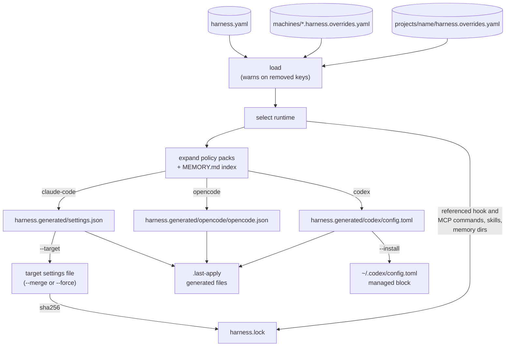

# harness, for humans

You are an operator: someone who installs harness, writes the YAML
manifest, runs `apply`, and watches the agent it configures behave the
way you said it should. This doc is the path from "fresh checkout" to
"my Claude Code session is gated by the rules I declared".

For the agent's view of the same system (which CLI verbs are safe to
call, how the gate messages read, how to read the ledger back), jump
to [`for-agents.md`](for-agents.md).

## 30-second pitch

`harness` is the declarative control plane for an agent harness. One
zod-validated `harness.yaml` describes grounding, tools, memory, hooks,
and policy packs. `harness apply` materialises that manifest
into the files Claude Code actually reads (`settings.json`, memory
indexes, sibling assets) and records a sha256 of every output in
`harness.lock`. You diff the manifest, not seven hand-edited files.

## Mental model



The manifest is the source of truth. Everything else is rendered. The
diagnostics (`validate`, `doctor`, `diff --since-apply`) tell you when
the rendered files have drifted from what the manifest currently says.

## Install

```bash
npm i -g @lannguyensi/harness
```

The CLI binary is `harness`. Node 20 or newer required.

## First-time setup (recommended)

If this is your first install on this machine, run the guided wizard:

```bash
harness init --interactive
```

It probes your environment (existing `~/.claude/` and `~/.codex/`, MCP
servers registered in Claude Code's user-scope registry `~/.claude.json`,
harness binary version), asks you to
pick a profile (`solo` / `team` / `full` / `custom`; `team` and `full` assume an agent-tasks account, `solo` is standalone), and writes a
validate-clean starting `harness.yaml` to `~/.harness/harness.yaml`
(legacy `~/.claude/harness.yaml` only when a pre-`v0.24.0` install is
already there).
Ctrl-C at any prompt aborts with no partial write. At the end it
offers to wire the manifest now: a checkbox per runtime, with the
runtimes it detected pre-checked, and for each one you tick it runs the
matching `harness apply`. Untick everything to review the manifest
first; the wizard then prints the commands to wire it by hand. Full walkthrough and
limitations in [`init-interactive.md`](init-interactive.md).

If you prefer a non-interactive bootstrap (CI, fresh-VM provisioning),
the next section walks the manual template path.

## First five minutes (manual template path)

1. Bootstrap a starter manifest into `/tmp/harness-demo/`:

   ```bash
   harness init --template solo --config /tmp/harness-demo/harness.yaml
   ```

   Valid templates: `minimal` (header only), `solo` (memory-router +
   branch-protection pack), `team` (solo + agent-tasks +
   grounding-mcp), `full` (the reference manifest: grounding, the tool
   inventory, memory and the branch-protection pack).

2. See what is in it:

   ```bash
   harness describe --config /tmp/harness-demo/harness.yaml --pillar tools
   harness list mcp --config /tmp/harness-demo/harness.yaml
   ```

3. Lint it:

   ```bash
   harness validate --config /tmp/harness-demo/harness.yaml
   harness doctor   --config /tmp/harness-demo/harness.yaml --shallow
   ```

4. Render the configured surfaces:

   ```bash
   harness apply --config /tmp/harness-demo/harness.yaml
   ```

   Output lands in `/tmp/harness-demo/harness.generated/`. By default
   nothing escapes that directory.

## Wire into Claude Code

To make Claude Code actually use the rendered settings, point `apply`
at a real settings discovery path with `--target`:

```bash
# Project scope: write straight to .claude/settings.local.json (created if missing).
harness apply --target .claude/settings.local.json

# User scope: merge harness-owned keys into your existing ~/.claude/settings.json,
# preserving env, permissions, enabledPlugins, and any other top-level keys.
harness apply --target ~/.claude/settings.json --merge
```

`--merge` replaces the target's `hooks` key wholesale with the
generated hooks and preserves every other top-level key verbatim.
`hooks` has no stable per-entry identity in the settings shape, so
hand-added hooks belong in the manifest (`harness adopt` pulls them
in). Re-applying is idempotent: running twice produces the same
target, and the second run reports `no changes`.

`harness apply` does not write MCP servers into `settings.json`,
because Claude Code does not read that block. Under `--merge`,
`mcpServers` entries that an earlier release wrote into the target, as
recorded in `.last-apply`, are dropped, and entries you added by hand
stay. Claude Code MCP servers are registered with
`claude mcp add-json --scope user <name> '<json>'`: `harness init
--interactive` does this for every enabled `tools.mcp[]` entry when
you tick claude-code in its wire-now step, and
after `harness add mcp` you run the command that `harness doctor`
prints under "Claude Code MCP Registration".

If the target exists and you pass neither `--merge` nor `--force`,
`apply` refuses with a clear hint instead of clobbering. `--force`
overwrites with the generated content as-is (no merge).

`harness.lock` records the target path plus a sha256 of the merged
output, so `harness validate --check-lock` flags out-of-band edits.

The diagram shows what one `harness apply` reads and writes for each
runtime, and where `--target` and `--install` fit. `.last-apply` keeps
the generated files; `harness.lock` hashes the hook and MCP commands,
skills and memory directories the manifest references, plus the
`--target` file.



## First hour: a real gate

The shipped gate is `branch-protection`: a `PreToolUse` hook that asks
git for the branch of the directory each `Write` / `Edit` (or
`apply_patch` on Codex) call writes into, and refuses when git names a
protected branch (default: `master`, `main`, `develop`). Enable it and
render the config:

```bash
harness pack add branch-protection
harness validate
harness apply --target ~/.claude/settings.json --merge   # Claude Code; then restart it
```

See the gate decide without starting an agent: from inside a
repository on a protected branch, pipe a sample `Write` event into the
hook.

```bash
echo '{"session_id":"demo","tool_name":"Write","tool_input":{"file_path":"README.md"}}' \
  | harness pack hook branch-protection
```

On a protected branch it emits Claude Code's deny shape on stdout,
carrying both the legacy `decision: "block"` field and the Claude Code
2.1+ `hookSpecificOutput` envelope; on a feature branch it allows the
edit and says why on stderr. (`--runtime codex` blocks with exit 2 and
the reason on stderr instead.)

### Splitting the agent surface from the operator surface (`ux:`)

The pack's `config.ux:` block replaces the agent-facing
`permissionDecisionReason` with a plain-language three-section message
(`cannot` / `required` / `run`, `${BRANCH}` substituted). The
engine-vocabulary diagnostic (the directory git was asked about, the
protected list) stays on stderr for the operator. Every built-in
template (`solo` / `team` / `full`) ships the `ux:` defaults on the
branch-protection pack. The agent-facing reference is
[`for-agents.md`](for-agents.md#agent-facing-block-messages-ux-block).
Full pack reference:
[`docs/policy-packs/branch-protection.md`](policy-packs/branch-protection.md).

## What you should NOT do

- Do not hand-edit anything under `harness.generated/`. The next
  `apply` refuses until the edit is captured with `harness adopt` or
  discarded with `--overwrite-drift`. Edit the manifest instead.
- Do not bypass `harness.lock` drift warnings. They are the only
  signal that something other than `apply` touched a managed file.
- Do not mix `apply --target ...` with manual `cp harness.generated/
  ~/.claude/settings.json`. Pick one path.
- Do not skip `validate` before committing. The schema catches
  misnamed hooks and bad duration strings before they ship. A
  manifest that does not load fails the branch-protection hook closed:
  it refuses every edit until the manifest loads again.

## Pause and resume (recovery / debug / incident-mode only)

Three situations need a way to make harness hooks dormant for a few
minutes without `npm uninstall -g` and without hand-editing
`settings.json`:

1. **Lockout recovery.** A misconfigured gate is rejecting your shell.
2. **"Is this harness or my code?" debug.** You want to A/B-test
   whether a gate is responsible for a surprising block.
3. **Incident / hotfix.** Prod is down, an unrelated preflight is
   failing, and you need to push the fix now.

The verbs are intentionally narrow:

```bash
harness pause                  # default 15m auto-resume
harness pause --for 5m         # explicit window
harness pause --for 1h --reason "prod incident #482"
harness resume                 # cuts the pause short
```

While paused, the `harness pack hook
runtime-reality` hook emits a one-line
stderr notice (`harness <hook>: PAUSED since 3m ago (reason: ...);
auto-resumes in 7m. Run \`harness resume\` to re-enable.`) and allow
the tool call without evaluating. After the
window expires, the next hook fire silently deletes the sentinel and
resumes normal gating.

Branch-protection does not yield to a pause: it keeps refusing edits
on a protected branch. To land an edit on a protected branch on
purpose (a hotfix on `master`, for example), switch that gate off from
an operator shell as
[Disable the gate](policy-packs/branch-protection.md#disable-the-gate-operator-only)
describes (Claude Code and Codex differ), and switch it back on
afterwards.

**Operator-only by design, but the CLI check is a speed bump, not a
boundary.** `harness pause` refuses to run when any of
`$CLAUDE_CODE_SESSION_ID` (what Claude Code actually exports),
`$CLAUDE_SESSION_ID` (legacy), or `$CODEX_SESSION_ID` is set, and
refuses non-TTY stdin without `--i-am-the-operator`. Do **not** try to
satisfy this by prefixing the command with `! ` in Claude Code: the `!
`-prefixed shell inherits this same session's environment *and* its
non-TTY stdin, so it is indistinguishable from an agent Bash call and
trips the exact same checks (verified live). Run the verb from a
terminal genuinely **outside** the agent session (a separate terminal
window or tab, not spawned by or nested inside this one). If an agent
ever asks you to pass `--i-am-the-operator` on its behalf, that request
IS the attack this guard exists to stop: refuse it.

The CLI check is all there is. The PreToolUse deny-policy layer that
used to deny `harness pause` / `harness resume` / `harness gate
disable` / `harness gate enable` from the agent's Bash tool went with
the policy engine (removed in 1.0.0), so nothing in harness stops an
agent that strips the session environment (`env -u
CLAUDE_CODE_SESSION_ID ... harness pause --for 1h --i-am-the-operator`)
or runs `harness gate disable` from its Bash tool. The checks above
still refuse the honest mistakes (an agent Bash call that inherits the
session env, a `! `-prefixed shell); treat them as a speed bump, not
a boundary. The trust model is documented in
[`docs/okf/pause-vs-gate-kill-switch.md`](okf/pause-vs-gate-kill-switch.md).

**Pause is not for routine gate bypass.** Two rules of thumb:

- **To turn a shipped gate off for good**, set `policy_packs[].enabled:
  false` on the pack (branch-protection) or remove the hook entry from
  the manifest, then re-apply. Persistent, diff-able,
  source-controlled.
- **For lockout recovery / debug / incident**, pause is the right
  tool, but always with `--for <duration>` so a forgotten pause
  cannot silently disable your gates across sessions.

`--indefinite` exists for genuinely open-ended recovery flows but
requires `--i-am-the-operator-and-accept-no-auto-resume` as a separate
flag; the verbose flag itself is the friction.

Audit trail: every pause / resume writes an
`harness-paused:<pausedAt>` / `harness-resumed:<pausedAt>` fact to
the evidence ledger, under the `default` session bucket (an operator
shell has no agent session id). `harness audit` replays only
`policy_decision` rows, so these facts are read back through
grounding-mcp's ledger query, not through `harness audit`.

**Trust boundary.** The sentinel file is plain JSON at
`<generatedDir>/.harness-paused` with no signature. The
operator-only CLI checks (agent-session env-var refusal, any of
`$CLAUDE_CODE_SESSION_ID`, `$CLAUDE_SESSION_ID`, `$CODEX_SESSION_ID`,
plus non-TTY refusal) are not a boundary against an agent that
strips the environment before calling the verb, and they do not see
a direct filesystem write to the sentinel path from a non-Bash tool
at all. The agent surface typically does not need write access to
`harness.generated/` for anything else. Signing
the sentinel (HMAC) would close this class properly but is not
implemented; treat it as a follow-up if you need a hard guarantee here.

## Diagnostics cheat-sheet

| You want to know | Run |
|------|------|
| Effective merged manifest, with overrides applied | `harness describe` |
| One pillar only (grounding, tools, memory, hooks) | `harness describe --pillar <name>` |
| Flat row-per-entry view of one category | `harness list <category>` |
| Schema + asset issues (warnings + errors) | `harness validate` |
| Schema issues, plus drift since last `apply` | `harness validate --check-lock` |
| Health summary across all pillars (MCP probes, hook executability, memory dir state) | `harness doctor` |
| What changed since I last ran `apply` | `harness diff --since-apply` |
| Replay the historical policy decision rows (written pre-1.0.0) | `harness audit --since 24h` |
| Full chronological session export (transcript + ledger, redacted) | `harness session-export <sessionId>` |
| Temporarily make the hooks dormant, branch-protection excepted (recovery / debug / incident) | `harness pause --for <duration>` |
| Re-enable hooks before the pause window expires | `harness resume` |
| Edit a protected branch on purpose (branch-protection off, from an operator shell) | see [Disable the gate](policy-packs/branch-protection.md#disable-the-gate-operator-only) |

## Where to read next

- [`docs/for-agents.md`](for-agents.md): how agents interact with the
  same harness instance, the gate messages, reading the ledger back.
- [`docs/ARCHITECTURE.md`](ARCHITECTURE.md): the original design
  (historical); [`docs/CLI.md`](CLI.md) is the current command
  reference, including the manifest's top-level keys.
- [`docs/ROADMAP.md`](ROADMAP.md): phases 1 through 7 with acceptance
  criteria.
- [`docs/VISION.md`](VISION.md): long-form positioning.
- [`docs/examples/full-manifest.yaml`](examples/full-manifest.yaml): a
  manifest that exercises every field.
- [`CHANGELOG.md`](../CHANGELOG.md): what shipped when.
