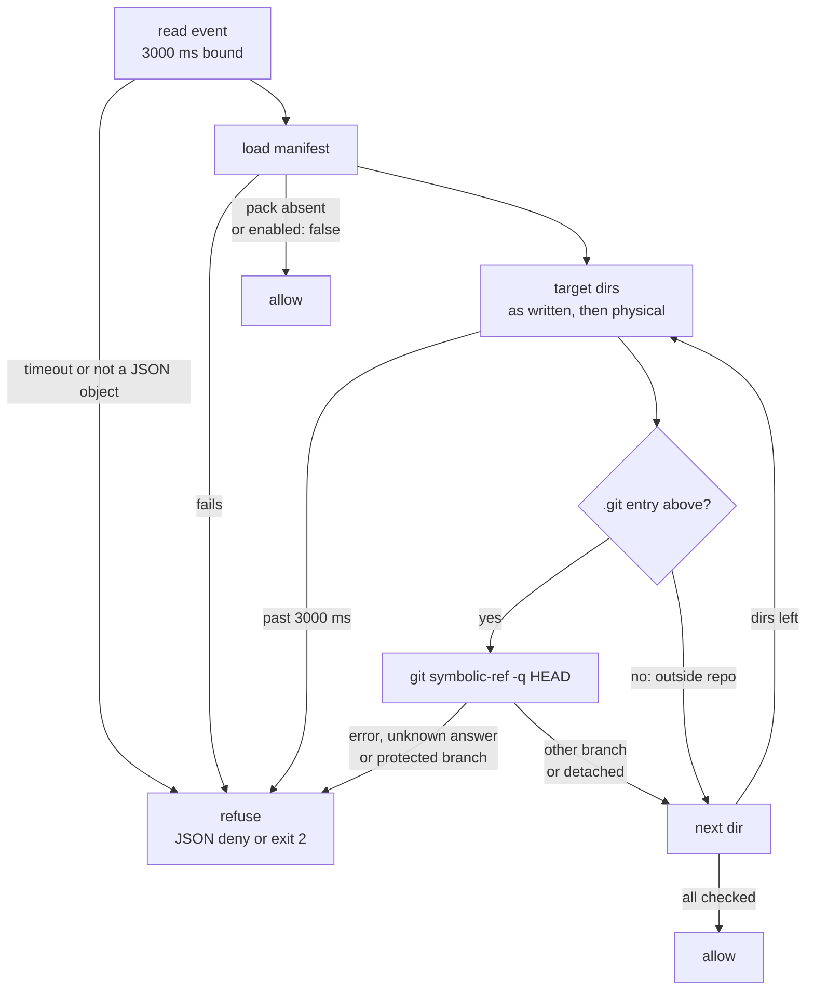

# Policy Pack: `branch-protection`

Block `Write`/`Edit` (claude-code) or `apply_patch` (codex) when the tool
call writes into a repository whose checked-out branch is protected. The
gate fires at the **first** source mutation, before any edit lands on the
protected branch.

Motivating incident: a session that branches AFTER it has already
edited master leaves an uncommitted diff on master that a second
session only notices on the next `git checkout master`. Recovery
requires stash + branch + commit-rewrite, strictly worse than
branching upfront.

## Status

Enabled in the `full` template since v0.17.2 and in the `solo` and `team` templates since task e2d5e87e. Opt-in for the minimal template; enable there with:

```bash
harness pack add branch-protection
harness apply
```

## How it works

The pack contributes one hook: a **PreToolUse blocker**
(`harness pack hook branch-protection`, `blocking: hard`, budget 5000 ms)
on `Write|Edit` (claude-code) or `apply_patch` (codex, as
`harness pack hook branch-protection --runtime codex`). The command written into the runtime config is a guarded line, not the bare command; see "Missing or broken `harness` binary" near the end of this page.

On every call the blocker asks git for the branch (task `a4d8adc5`); it
never reads git's files itself, and it keeps no ledger tag, session
state or override marker.

1. **Directories, judged twice.** Every tool call is judged in two ways,
   and the blocker refuses when either judgment refuses or cannot answer;
   it allows only when both allow. A write is judged in the directory its
   path names as written and in the directory the operating system
   resolves that path to; the two items below say which paths each
   judgment takes. The as-written judgment runs first.
   - **As written.** Each path is made absolute against the event cwd,
     with `.` and `..` resolved on the text (as `path.resolve` does) and
     symlinks left in place. For `Write`, `Edit`, `MultiEdit` and
     `NotebookEdit` it takes the nearest existing directory holding the
     target path. For a Codex `apply_patch` it does the same for every path
     named by an `*** Add File:`, `*** Update File:`, `*** Delete File:` or
     `*** Move to:` header line of the patch text in `tool_input.patch`,
     `tool_input.input` or a string `tool_input`. For any other tool, or
     without such a header there, it takes the event cwd.
   - **Physical.** Each path is taken as the operating system resolves it:
     symlinks are followed and `..` steps up from the directory reached so
     far, which is where `git -C` looks. For `Write`, `Edit`, `MultiEdit`
     and `NotebookEdit` it takes the nearest existing directory of the
     target path (a `Write` may create the directories in between) and,
     when the target is itself a symlink, the directory the symlink leads
     to as well (one that does not resolve yet is followed by its text).
     For a Codex `apply_patch` it does the same for every path named by a
     header line found in any string of the event: any field or array of
     `tool_input`, `raw_input` or `input`, and JSON text inside a string.
     The field Codex carries the patch text in is not pinned on a captured
     payload, so this judgment relies on no single field. A relative path
     resolves against the event cwd and, when the tool input names a
     per-call `workdir` or `cwd`, against that as well. For any other tool,
     or a patch without a header, it takes the event cwd (and that
     per-call directory).

   Each distinct directory is checked, and git is asked once per
   directory it runs in.
2. **Presence walk.** From the directory up to the filesystem root it
   looks (with `lstat`, nothing is read) for an entry named `.git`: along
   the directory's text for the as-written judgment, along the physical
   directory for the other. When there is none, the directory is outside
   every repository and git is not run. An `lstat` that fails for another
   reason than a missing path (a directory that cannot be searched, a
   symlink loop) counts as present, and git decides.
3. **git.** Otherwise it runs `git -C <dir> symbolic-ref -q HEAD`
   directly (no shell), with stdin closed, each output stream capped at
   4 KiB, every `GIT_*` variable removed from git's environment
   (`LC_ALL=C`, `GIT_TERMINAL_PROMPT=0`, `GIT_OPTIONAL_LOCKS=0` set;
   `HOME` kept, so your global git configuration applies as it does to
   your own git), and a 2000 ms bound per call after which git is killed.
   Resolving the paths and all git calls of one tool call together are
   bounded at 3000 ms, counted from the moment the hook starts (the stdin
   read included); past the bound the call is refused. That is well below
   the hook budget: a hook the runtime kills at its budget would be read
   as an allow.

The diagram shows the decision path of one tool call: every answer the
blocker cannot get refuses, and, when the pack is on, it allows only
after every directory has been checked.



## The three outcomes

| git says | The tool call | What to do |
|---|---|---|
| `refs/heads/<name>` and `<name>` is protected (compared case-insensitively, so `Master` counts as `master`) | **refused** | Branch off: `git checkout -b <feature>`, then retry. |
| anything it cannot answer: an error exit (an exit 1 with any output on stdout or stderr included, such as a wrapper in front of git that fails), a signal, no answer within the bound, git missing from `PATH`, output past the cap, or an exit-0 answer that is not `refs/heads/<name>` (a `HEAD` naming a tag, for example) | **refused**, with one fixed sentence naming git's first stderr line | Fix the repository (run `git -C <dir> symbolic-ref -q HEAD` yourself to see what git says), or disable the gate from an operator shell (below). |
| nothing, because there is no `.git` entry above the directory (outside every repository) | **allowed** | Nothing. |

A detached HEAD (git exits 1 with no output on stdout or stderr) is
allowed as well: an edit there does not land on a protected branch by
itself, and pushes are outside this gate's scope.

A planted layout git does not accept (a broken `HEAD` in a nested
`.git`, for example) either stops git with an error (refused) or makes
git resolve the enclosing repository, which is then judged on its own
branch, exactly as your own git would.

## Failure mode

The blocker fails **closed**: a manifest that does not load, an event on
stdin that is not a JSON object, a stdin that never closes within 3000 ms
and every git error refuse the call. The stderr diagnostic
(`harness pack hook branch-protection: BLOCK: ...`) names the directory
and what git said, for operator audit.

The pack fails closed on purpose. Its whole job is preventing
edit-on-master incidents; a bug that silently allowed Writes through would defeat
the purpose.

A manifest that still carries a key or a pack a newer release removed
does not count as one that fails to load: removed entries are stripped
with a warning (`harness validate`, `harness doctor`) and the gate keeps
working. Only a key that was never valid fails the load.

## Block contract per runtime

| Runtime | Refusal | Allow |
|---|---|---|
| claude-code | one JSON line on stdout, `{"decision":"block","reason":...,"hookSpecificOutput":{"hookEventName":"PreToolUse","permissionDecision":"deny","permissionDecisionReason":...}}`, exit 0; when the envelope cannot be written to stdout (the reader is gone or the write fails), the reason on stderr, exit 2 | nothing on stdout, exit 0 |
| codex (`--runtime codex`) | the reason on stderr, exit 2, nothing on stdout | nothing on stdout, exit 0 |

An unknown `--runtime` value refuses with exit 2, which both runtimes read
as a block. The agent-facing text names `git checkout -b` as the way
forward and nothing else.

## Configuration

```yaml
policy_packs:
  - name: branch-protection
    config:
      # Override the default ["master", "main", "develop"] list.
      protected_branches:
        - main
        - release/prod
        - production
      # Agent-facing block message (v0.17.3+; default shipped by every init template).
      ux:
        cannot: "You cannot edit files on protected branch ${BRANCH} yet."
        required:
          - "a checkout of a non-protected branch (current `${BRANCH}` is protected)"
        run:
          - "git checkout -b feat/<your-task>"
```

A malformed `protected_branches` value (not an array, empty, all
non-string entries) falls back to the default list with a warning
surfaced at `harness apply` time.

### Config schema

Since task `d78fb3c7`, the pack's `config:` block is validated by `harness validate` and `harness doctor` against a strict zod schema. Typo'd keys (`protected_brnches`) now fail at lint time. The accepted keys are:

| Key | Type | Notes |
|---|---|---|
| `protected_branches` | array of non-empty strings | optional; default `["master", "main", "develop"]`; compared case-insensitively |
| `ux` | `PolicyUxSchema` (`cannot` + `required[]` + `run[]`) | optional; agent-facing remediation render, see below |

Any other top-level key is rejected as a typo.

### Pack-level `min_version` (task `bd154095`)

`policy_packs[].min_version` is an optional floor on the canonical package-side bin. The `branch-protection` blocker is harness itself, not a separate binary; this pack therefore has no version probe registered, and declaring `min_version` on it surfaces a `no version probe registered` warning at `harness doctor` time so the operator's expectation is visible. Leave the field unset on this pack.

### `config.ux` (v0.17.3+)

On a protected branch the blocker renders `config.ux` in the plain-language `{ cannot, required, run }` shape via `renderAgentFacing` (`src/runtime/agent-facing.ts`). `${BRANCH}` substitutes the branch git named, so on a Write attempt against master the agent sees:

```
You cannot edit files on protected branch master yet.

Required:
- a checkout of a non-protected branch (current `master` is protected)

Run:
  git checkout -b feat/<your-task>
```

Without `ux:` the agent sees the default text (`branch-protection: refusing Write on protected branch "master" ...`, the `git checkout -b <feature>` line and the protected list). A refusal because git could not answer always uses its fixed sentence, whatever `ux:` says. A refusal text longer than 4096 UTF-8 bytes is cut on a character boundary and followed by a `[truncated N bytes]` marker that names the dropped bytes, and a shorter one is delivered unchanged; a manifest load error can be far larger than that, so the agent sees the start of it. The branch-protection blocker resolves `${BRANCH}`, `${TOOL_NAME}`, and `${SESSION_ID}` (the event's session id, empty when absent); other builtins (`${REPO}`, `${CWD}`) are not provided by this pack's hook. Verbatim three-section form and the agent / operator surface split are documented in [`docs/for-agents.md`](../for-agents.md#agent-facing-block-messages-ux-block).

A wording fix to this text only reaches manifests generated by a fresh `harness init` after the fix ships; an already-installed manifest's `config.ux` stays on the old wording until refreshed. `harness doctor` warns on divergence and `harness pack reseed branch-protection [--dry-run]` pulls the current shipped wording in, leaving every other key on the pack entry (e.g. `config.protected_branches`) untouched. A manifest whose `ux.run` still lists the removed `harness session-start branch-check` line is such a divergence: reseed drops it.

## Escape hatches

### Branch off (the agent)

```bash
git checkout -b <feature>
```

The next call is judged against the new branch; there is nothing to
refresh.

### Disable the gate (operator only)

When you have a deliberate reason to edit a protected branch (version
bumps, CI workflow patches, hotfixes), switch the gate off from an
un-hooked operator shell, not from the agent's session:

- Claude Code: `harness gate disable` (run it without `--matcher` first
  to list the hook groups, then with the matcher of this pack's group);
  `harness gate enable` restores them.
- Codex: `harness gate disable --runtime codex` (run it without
  `--matcher` first to list the hook units of the harness-managed block
  in `~/.codex/config.toml`, then with the matcher of this pack's unit,
  for example `apply_patch`); `harness gate enable --runtime codex`
  restores it. The gate empties the unit's `hooks` array in place
  (`hooks = []`) instead of deleting the unit, so every other hook keeps
  its position and Codex keeps its trust. A later
  `harness apply --runtime codex --install` re-renders the block and
  brings the unit back. Alternatively set `enabled: false` on this pack
  and re-run `harness apply --runtime codex --install`.

The off switch for this gate is the `harness gate disable` / `harness gate enable` pair above; the removed `harness pause` verb (task 973163a4) never switched this gate off either.

### Removed in task `a4d8adc5`

`harness session-start branch-check` (the SessionStart producer and its
`branch:non-protected:<branch>` ledger tag) and
`harness approve branch-protection` (the override marker under
`harness.generated/.approvals/`) are gone, together with the 5-minute
freshness window and the session-id requirement. After upgrading, re-run
apply once per runtime you use (`harness apply --runtime claude-code`,
`harness apply --runtime codex --install`; a plain `harness apply` reuses
the runtime of the last apply) so the settings stop calling the removed
producer.

## Out of scope (v1)

- Locking down `git` itself (would create false-positive churn on
  read-only commands like `git status`).
- Auto-branching on Write attempt (silent autocorrect is wrong; the
  agent should be the one who notices and branches).
- Allowlist of paths that are safe to edit on master (CHANGELOG.md,
  package.json version bumps). Open for v2 if operators report
  friction.
- A bare repository's own directory: it has no `.git` entry, so the
  presence walk counts it as outside every repository.

## Missing or broken `harness` binary (PATH drift)

The hook is started by the agent process, which resolves `harness`
through its own PATH. When it cannot (the usual way: you switched Node
with nvm, so the npm global bin directory that holds `harness` is no
longer on the PATH the agent was started with), a bare hook command
would fail with exit 127. A `harness` that is found but cannot start
fails the same way: `#!/usr/bin/env node` with node off the PATH exits
127, a bad interpreter or a module load error exits 1. Both Claude Code
and Codex read only exit 2 on a `PreToolUse` hook as a block; any other
non-zero exit is a non-blocking error and the tool call runs, which would
leave every protected branch unguarded without a sign. So the generated
hook line checks first, runs the hook, and answers the way a block does
for everything that is not the hook's own answer:

```sh
/bin/sh -c 'command -v harness >/dev/null 2>&1 || { echo "harness not found on PATH: ..." >&2; exit 2; }; harness pack hook branch-protection; rc=$?; [ "$rc" -eq 0 ] || [ "$rc" -eq 2 ] || { echo "harness hook could not run (exit $rc), ..." >&2; exit 2; }; exit "$rc"'
```

- `harness` missing: exit 2, `harness not found on PATH: ...` on stderr.
- The hook exits 0 (allow, or Claude Code's JSON deny envelope on stdout)
  or 2 (its own block): passed through, with stdin and stdout untouched.
- Any other exit (a crash, a signal, 127, 1): exit 2, `harness hook could
  not run (exit N), ...` on stderr.

The hook is a child of the shell, not `exec`ed, so a runtime that kills
the hook at its timeout kills the shell and orphans the hook process. The
orphan keeps the inherited pipes and runs to completion within its own
bounds (about 3 s), so its stdout can still arrive after the shell was
killed; only a block can be late, because the hook writes nothing to
stdout when it allows. A timeout kill reads as an allow either way, which
is why the hook bounds itself below its 5000 ms budget. The wrapper is `/bin/sh -c '...'` because Codex
starts a hook with the user's `$SHELL`, which is not always POSIX; the
quoted word is parsed the same way by every shell and the guard itself
always runs under `sh`.

While `harness` is missing or broken, every `Write`/`Edit` (or
`apply_patch` on Codex) is refused, and the reason shown to the agent
tells it to ask the operator and not to edit hook settings. Recovery is
the operator's, and does not need a working `harness`: put `harness` back
on the PATH of the process that starts the agent and restart the agent
(`nvm use <the version harness was installed under>`, or add the npm
global bin directory, `export PATH="$(npm prefix -g)/bin:$PATH"`, to your
shell rc), or fix its Node. If that cannot be done now, from an editor or
a shell that is not the guarded agent, remove the branch-protection group
(event `PreToolUse`, matcher `Write|Edit`) from the settings file harness
wrote (default `~/.claude/settings.json`; `CLAUDE_CONFIG_DIR`, a
`harness apply --target` path or `--codex-config` move it) by hand, and
for Codex the `apply_patch` hook table of the harness block in
`~/.codex/config.toml`. That leaves the branch unguarded: once `harness`
runs again, restore protection with `harness apply --target <that file>
--merge` (Claude Code) or `harness apply --runtime codex --install`
(Codex). `harness gate disable` is the supported switch once `harness`
runs.

`harness doctor` reports this state as an error when the pack is
installed and `harness` does not resolve on the PATH doctor sees (a
`harness binary` entry, whatever the npm prefix says, because an nvm
switch can leave the active Node's npm bin directory on the PATH while
`harness` lives under another prefix). Doctor checks its own PATH: an
agent started from a different environment is not covered, and a
`harness` that resolves but crashes is not found by it.

An upgrade from a release that wrote the bare line needs `harness apply`
again (`--target ... --merge` for Claude Code, `--runtime codex
--install` for Codex): the apply replaces the old entry, it does not add
a second one. Until then `harness doctor` shows the old line as a hook
that differs from the generated one (or as disabled, when
`harness gate disable` took it out), and `harness uninstall` and
`harness gate enable` accept either spelling.

## Test fixtures

- `tests/cli/pack-hook-branch-protection.test.ts`, the blocker against real git, the injected git runner and the per-runtime contract
- `tests/runtime/git-branch.test.ts`, the branch reader
- `tests/runtime/git-branch-differential.test.ts`, the gate against git run plainly over the repository layouts
- `tests/cli/hook-git-context-fifo.test.ts`, a git file that never answers, through the built CLI
- `tests/cli/manifest-posture.test.ts`, removed manifest keys warn and are ignored
- `tests/policy-packs/branch-protection-runtime.test.ts`, helpers
- `tests/policy-packs/branch-protection-expand.test.ts`, pack expansion
- `tests/policy-packs/guarded-harness-command.test.ts`, the guarded hook line run under `sh -c` with and without `harness` on the PATH
- `tests/cli/guarded-hook-upgrade.test.ts`, upgrade, uninstall and gate enable over the bare and the guarded line
- `tests/cli/doctor-guarded-hook-path.test.ts`, the doctor PATH finding as an error
